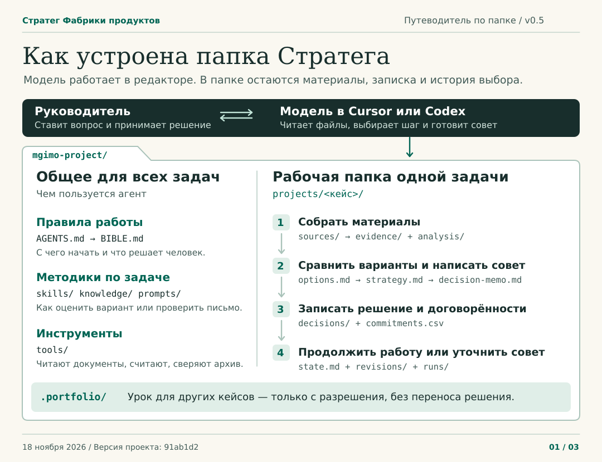

# Стратег за один кейс. «Тихий час»

У руководителя небольшого B2B-сервиса вопрос: «Стоит ли запускать платный пилот уведомлений для клиник на три месяца?» За один проход вы получите короткую записку, проверите решающую строку, внесёте поправку и вернётесь к тому же выбору из нового чата. Данные [учебного кейса](../../evals/cases/decision-economics/brief.md) вымышлены. Записку и расчёт ниже можно прочитать прямо здесь. Чтобы пройти маршрут самому, нужен редактор с доступом к модели и Python 3.11+; команды подготовки приведены для Linux/macOS. Поиск и контакты с клиниками не нужны.

## 1. Откройте кейс и задайте вопрос

Откройте корень репозитория в агентном редакторе. В терминале из корня один раз создайте рабочую копию [сохранённого кейса](../pilot-v03/raw/folder-initial/results/). Если `projects/quiet-hour` уже существует, команда остановится на `mkdir`. Продолжайте с существующей копией, если это тот же учебный кейс.

```sh
(
  set -e
  mkdir -p projects
  mkdir projects/quiet-hour
  cp -R docs/pilot-v03/raw/folder-initial/results/. projects/quiet-hour/
)
```

Отправьте в чат:

> Продолжи `projects/quiet-hour`. Стоит ли запускать платный пилот уведомлений для клиник на три месяца? Дай мне записку для встречи в пяти строках: совет, его основание, сильнейшее возражение, точная строка источника и статус человеческого выбора. Сверь решающее число с оригиналом. Пока только прочитай кейс.

У исходной записки уже есть ответ: **сначала короткая ручная проверка (O-2)**. Сценарий продуктового пилота (O-3) даёт **+165 000 ₽ за три месяца при 30 платящих аккаунтах**. По выводу `C-006` откройте утверждения `E-012` и `E-015`, затем [строку 2 исходной таблицы](../pilot-v03/raw/folder-initial/results/sources/originals/S-001__economics.csv#L2). В ней ставка **1 500 ₽ за аккаунт в месяц**, а объём помечен `forecast_not_demand`. Три месяца указаны [в брифе, строка 3](../../evals/cases/decision-economics/brief.md#L3). Главное возражение против O-2: ручная проверка измерит ценность услуги, а ценность будущей автоматизации останется открытым вопросом. [Исходная записка](../pilot-v03/raw/folder-initial/results/decision-memo.md) сохранена как была, включая ошибку: 10 инженерных дней в ней названы необходимыми, хотя [команда указала **доступное** время](../../evals/cases/decision-economics/product.md#L3). Сметы работ нет.

## 2. Передайте поправку и получите один выбор на сегодня

В том же чате отправьте:

> Пришла поправка `evals/cases/decision-economics-update/supplier-update.md`. Продолжи `projects/quiet-hour`: проверь, какие основания и цифры она меняет. Сохрани прежние версии и обнови записку и кейс по правилам папки. Что теперь делать и что можно сказать клинике? Я пока ничего не утверждаю. Меняй только рабочую копию кейса; клиникам ничего не отправляй.

[Поправка, строка 2](../../evals/cases/decision-economics-update/supplier-update.md#L2) заменяет 1 500 на **4 800 ₽ за аккаунт в месяц**. Это оценка поставщика. При 30 платящих аккаунтах модель теперь даёт **−132 000 ₽ за три месяца**. Для безубыточности по этой модели нужны **67 аккаунтов**, которые платят весь срок. Ручная услуга по своему трёхмесячному сценарию при 20 аккаунтах даёт **+48 000 ₽**. Стоимость короткой ручной проверки ещё предстоит оценить. Совет O-2 был и до поправки. Теперь экономическое основание против немедленного O-3 сильнее, а порог «продукт обгоняет ручной вариант с 22 аккаунтов» больше не действует.

Если хотите сами сверить обе суммы после поправки, [CSV для проверки](../verification-pilot/corrected.csv) отличается от исходной таблицы только ставкой поставщика. Из корня:

```sh
python3 tools/economics.py docs/verification-pilot/corrected.csv --months 3 \
  --expect-net paid_pilot -132000 --expect-net manual_service 48000
```

**Один вопрос директору.** Готовим короткую ручную проверку вместо запуска трёхмесячного пилота? Если да — составляем план проверки на 3–5 рабочих дней: один рабочий процесс, обезличенный CSV, критерий остановки. Если нет — не начинаем ни проверку, ни разработку. Само «да» здесь не выделяет сотрудника и не разрешает писать клиникам. Перед первым приглашением отдельно понадобятся ответственный, доступное время и разрешение на контакт.

**Готовый текст для клиники после разрешения на контакт.**

> Сервис собирает уведомления из обезличенного CSV в одну ежедневную сводку. Это не уведомления в реальном времени; интеграции с МИС сейчас нет. Пригодилась бы такая сводка вашему администратору? Медицинские данные не присылайте.

Возможности и ограничения для этой фразы зафиксированы в `C-007` → `E-003`, `E-004` → [описании продукта, строка 2](../pilot-v03/raw/folder-initial/results/sources/originals/S-003__product.md#L2).

**Реальный выбор — `pending`.** Рекомендация лежит в `projects/quiet-hour/decision-memo.md`. До явного ответа руководителя в `projects/quiet-hour/decisions/decisions.csv` остаётся только заголовок, а обязательства в `commitments.csv` имеют статус `proposed`. Снимок до пересмотра доступен в `projects/quiet-hour/revisions/R-001-before/`.

## 3. Закройте чат и продолжите в новом

Откройте новый агентный чат в том же корне репозитория, без истории переписки. Отправьте:

> Продолжи `projects/quiet-hour`. Начни с `python3 tools/strategist.py resume projects/quiet-hour`. По сохранённой записке и журналу решений скажи, какая цифра изменилась, что мы рекомендуем и что я действительно утвердил. Покажи точную строку поправки и задай один следующий вопрос. Не повторяй импорт или пересмотр.

В рабочей копии после первого импорта поправка лежит в `sources/originals/S-005__supplier-update.md`, строка 2 (`S-005#line:2`). Из нового чата должны вернуться **−132 000 ₽, O-2 и `pending`**, а также тот же вопрос об ограниченной ручной проверке. `resume` читает сохранённое состояние и реестры. Проверка структуры помогает заметить повреждённый снимок. Спрос и результат проверки нужно подтверждать отдельно.

Для сравнения со своим результатом: [что агент ответил после поправки](../meeting-pilot/clinic-update.txt) и [что он восстановил в новом чате](../meeting-pilot/clinic-return.txt). Это ответы на одну учебную задачу, не готовые обязательства перед клиниками.

## Где лежат правила, данные и решение



[Инструкция входа](../../AGENTS.md) и [принципы Стратега](../../BIBLE.md) действуют для всех кейсов. Методики агент открывает по задаче. Внутри кейса оригиналы хранятся в `sources/`, цепочки от выводов к фрагментам — в `evidence/`, расчёты — в `analysis/`. Записка даёт совет на встречу, журнал хранит явный выбор человека, а `state.md` подсказывает следующий ход после перерыва.

[Отчёт в PDF от 18 ноября 2026](strategist-guide.pdf) и [схема из него](folder-map.svg) описывают версию 0.5 (`91ab1d2`). [Журнал проверок папки](../folder-evidence.md) собирает наблюдения из отдельных прогонов.
